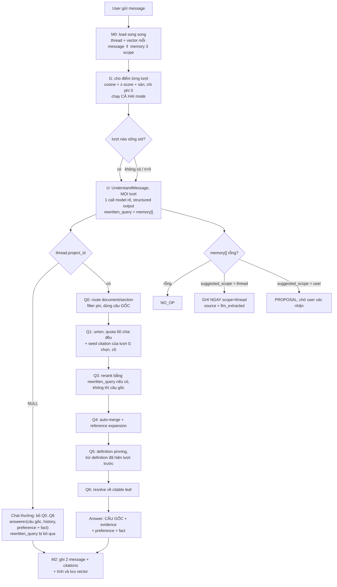
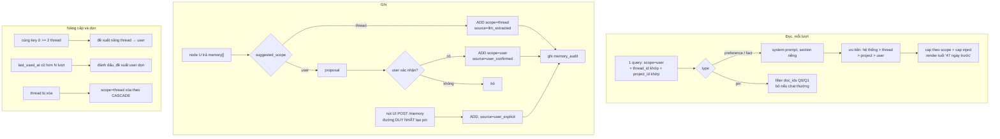

# Bước 2: Multi-turn và Memory

Cập nhật: 2026-08-05. Phiên bản 6.

> **§3 và §6 không còn mô tả hệ thống đang chạy.** Memory giờ được model sinh
> câu trả lời tự lưu qua tool, không còn node trích riêng; scope do tool quyết
> chứ không suy ra từ key; cap đầy thì evict chứ không đề xuất; `pin` đã bỏ.
> Trạng thái thực tế, kèm bảng đối chiếu từng khác biệt, ở
> [4.memory.md](4.memory.md). Tài liệu này giữ nguyên để còn đọc được *vì sao*
> từng quyết định được đưa ra — phần §0 (bốn lớp state), §4 (ví dụ bốn lượt) và
> §5 (thread dài) vẫn đúng.

Bước 1 lo tài liệu vào index. Bước này lo **hội thoại**: câu hỏi lượt 2 phụ thuộc lượt 1, và có thứ user muốn hệ thống nhớ qua nhiều hội thoại.

Lịch sử phiên bản ở §17. Ba quyết định nền:

- **Mọi message của user đi qua một node LLM duy nhất.** Node đó vừa viết lại câu hỏi vừa trích memory. Không có heuristic nào phán đoán trước (§3).
- **Memory mặc định là local.** Lên global phải có bằng chứng (§6.3).
- **Không có danh sách từ theo ngôn ngữ ở bất cứ đâu.** Đó là điều kiện để hệ thống chạy đa ngôn ngữ mà không mắc nợ bảo trì (§3.1).

---

## 0. Bốn lớp state, đừng gộp

Hai câu hỏi phân biệt chúng: **sống qua việc cắt history không**, và **sống qua thread không**.

| Lớp | Là gì | Qua cắt history | Qua thread | Chi phí mỗi lượt |
|---|---|---|---|---|
| **L1** turn buffer | message thô, cap 40 msg / 24k ký tự | ✗ | ✗ | 1 query Postgres |
| **L2** thread summary | nén các lượt giữa | ✓ | ✗ | 1 LLM call khi vượt ngưỡng |
| **L3** memory **local** | fact/preference đã trích, `scope=thread` | ✓ | ✗ | 1 query Postgres |
| **L4** memory **global** | fact/preference đã trích, `scope=user` | ✓ | ✓ | cùng query với L3 |

Bốn lớp trả lời bốn câu hỏi khác nhau:

- L1: "câu 'áp dụng cho ai' đang nói về cái gì?"
- L2: "40 lượt trước chúng ta đã bàn gì?"
- L3: "trong **cuộc này** user đã dặn gì?"
- L4: "user này là ai, muốn được trả lời kiểu nào?"

**Vì sao L1 và L2 không thay được L3.** User nói ở lượt 2 *"cuộc này trả lời bằng tiếng Anh giúp tôi"*. Tới lượt 60 thì message đó đã bị cắt khỏi cửa sổ L1. L2 summary **có thể** giữ, cũng có thể bỏ, vì nó tóm tắt nội dung chứ không đảm bảo giữ chỉ thị.

Tách vai cho rõ: **L2 giữ chuyện gì đã xảy ra, L3 giữ chỉ thị gì đã được đưa ra.** Nhờ tách vậy, L2 nhẹ đi và làm sau được, còn L3 rẻ nên làm trước.

**Cái gì KHÔNG phải memory:**

- Lịch sử hội thoại. Đó là L1 và L2.
- Nội dung tài liệu. Đó là index, đã có retrieval lo.
- Thứ suy ra được từ dữ liệu đang có. Ví dụ "user có 12 tài liệu" thì đếm, đừng nhớ.

---

## 1. Vấn đề cụ thể

```
Lượt 1  user: "Điều 5 Nghị định 15/2020 nói gì?"
        → embed "Điều 5 Nghị định 15/2020 nói gì?"   ✓ tín hiệu tốt

Lượt 2  user: "vậy áp dụng cho ai?"
        → embed "vậy áp dụng cho ai?"                 ✗ vô nghĩa
```

Đây là vấn đề **retrieval**, không phải generation. Thay mock bằng LLM xịn không sửa được gì, vì evidence đã sai từ trước khi tới bước sinh.

Hai biến thể khó hơn, cùng gốc:

```
Lượt 3  trợ lý vừa nói "Điều 5 quy định 3 nhóm: tổ chức, cá nhân cư trú,
        cá nhân không cư trú."
        user: "nhóm thứ ba là gì?"
        → tham chiếu trỏ vào CÂU TRẢ LỜI, không phải câu hỏi trước

Lượt 4  user: "thủ tục hoàn thuế GTGT gồm mấy bước?"
        → đổi chủ đề. Ghép với history là tạo nhiễu thuần.
```

---

## 2. Ranh giới: cái gì đi retrieval, cái gì vào context

Bốn câu hỏi quyết định, không dựa vào "loại dữ liệu":

1. **Có cần citation không?** Cần thì buộc qua retrieval, vì chỉ retrieval mang theo `locators`, `source_block_ids`, `media_refs`.
2. **Có bounded và luôn áp dụng không?** Luôn áp dụng thì nhét thẳng context.
3. **Nó có embed được không?** Chỉ thị không embed được. "Trả lời ngắn gọn" đi embed sẽ kéo về chunk nói về sự ngắn gọn.
4. **User đổi xong có cần hiệu lực ngay lượt sau không?** Retrieval có lag embed rồi upsert. Đọc Postgres thì tức thì.

Thêm chiều **kiểu thất bại**: retrieval hỏng thì suy giảm mềm. Chỉ thị hỏng thì fail cứng. Thứ fail cứng phải load tất định, không phụ thuộc reranker.

| Đi vào context (load tất định) | Đi qua retrieval | Là filter param |
|---|---|---|
| `preference` (cap theo scope) | chunk tài liệu | `pin` → `doc_ids` cho Q0/Q1 |
| `fact` | glossary/definition | |
| lượt đầu + K lượt cuối của thread | | |
| danh sách doc trong project (nếu < ~50 doc) | | |

Ngưỡng ngón tay:

```
dưới ~2K token   → load hết vào context. Retrieval machinery đắt hơn token tiết kiệm được.
2K tới ~10K      → tách index / body (§12)
trên ~10K        → buộc phải retrieval
```

---

## 3. Một node LLM cho mọi message

### 3.1 Quyết định nền: không phán đoán bằng heuristic

Đã bỏ hai heuristic, cùng một lý do:

| Đã bỏ | Vì sao |
|---|---|
| Cổng đoán câu tự đủ nghĩa (marker + neo + độ dài) | Trượt case `"Mức phạt bao nhiêu?"` (không marker nhưng thiếu ngữ cảnh). Lỗi im lặng theo chiều đắt. Danh sách marker phụ thuộc ngôn ngữ |
| Regex bắt pattern ghi nhớ (`nhớ`, `từ giờ`, `luôn`, ...) | Cùng vấn đề ngôn ngữ. Thêm nữa tiếng Việt có bẫy thật: `luôn` vừa nghĩa *always* vừa nghĩa *ngay lập tức* (`làm luôn đi`); `nhớ` vừa là lệnh vừa là hồi tưởng (`tôi nhớ là Điều 5...`). Mỗi ngôn ngữ cần một người bản ngữ soạn, không dịch được |

**Không còn danh sách từ theo ngôn ngữ ở bất cứ đâu trong thiết kế.** Đó là điều kiện để chạy đa ngôn ngữ mà không mắc nợ bảo trì.

**Quy tắc chốt:**

```
MỌI message của user  →  đi qua node UnderstandMessage
```

Không ngoại lệ. Không lượt đầu, không đổi chủ đề, không chat thường. Việc *có ngữ cảnh gửi kèm hay không* do G quyết định, nhưng việc *có gọi node hay không* thì không có điều kiện nào.

### 3.2 Hai lớp

| Lớp | Câu hỏi | Tín hiệu | Chi phí |
|---|---|---|---|
| **G** | Lượt nào trong history còn liên quan? | cosine query vs từng lượt | 0 |
| **U** `UnderstandMessage` | Viết lại câu hỏi, và có fact nào cần nhớ? | LLM structured output | 1 call rẻ, **mọi lượt** |

`Union` đứng sau làm lưới cho phần retrieval.

G chạy ở **cả hai mode**, kể cả chat thường, vì nó miễn phí (nhân vô hướng trên vector đã lưu) và giữ được một đường code duy nhất.

### 3.3 G: cho điểm và cắt

```
điểm[i] = cosine(vector query hiện tại, vector[message i])

  message user      → vector của text câu hỏi
  message assistant → vector suy từ CHUNK ĐÃ CITE, KHÔNG phải text sinh ra

n = 0        → không có ngữ cảnh, node vẫn chạy
n = 1..2     → lấy cặp hỏi-đáp gần nhất, CHỈ áp sàn cosine
               (z-score vô nghĩa với 1-2 mẫu)
n >= 3       → z-score normalize trong phạm vi thread
               giữ lượt có z > θ  VÀ  cosine thô > sàn

lượt assistant sống sót → kéo theo câu hỏi mà nó trả lời (cặp là đơn vị có nghĩa)
cap 5 lượt sống sót

không lượt nào sống → node chạy KHÔNG kèm ngữ cảnh
```

**Vì sao z-score.** Cosine thô không so được giữa các thread. [DyCP](https://arxiv.org/abs/2601.07994) normalize trước rồi mới đặt ngưỡng, nên ngưỡng không phụ thuộc scale và tác giả nói phương pháp "không quá nhạy với con số cụ thể".

**Vai trò sàn cosine đã đổi lần nữa.** Ở v4 nó là cổng chặn chi phí: loại hết thì không gọi LLM. Giờ node chạy vô điều kiện nên sàn **không còn gác tiền**. Việc duy nhất của nó là: **đừng đưa lượt lệch chủ đề vào prompt**.

Đó vẫn là việc cần làm, vì [Beyond Continuity](https://arxiv.org/abs/2605.09268) đo được LLM *"frequently carry stale context even with explicit cues"*. Đưa history lệch chủ đề cho model thì nó vẫn ghép vào. Nhưng đặt sàn sai giờ **rẻ hơn hẳn**: sai một chút chỉ làm prompt bẩn một chút, không mất một lần gọi hay thêm một lần gọi.

**Vì sao G vẫn cần dù node luôn chạy.** DyCP đo trên LoCoMo với GPT-4o được **26,53 EM khi prune so với 24,23 khi full context**. Cắt bớt thắng cho đủ. Cộng position bias: history dài thì model bỏ qua phần giữa. G là **tiền xử lý làm input tốt hơn**, không phải cổng tiết kiệm.

Vì có LLM đọc lại nên cap nới lỏng được: giữ 3-5 lượt thay vì đúng 1.

### 3.4 U: `UnderstandMessage`

Một node, một call, hai việc.

```
model      rẻ, không dùng model chính
input      câu hiện tại
           + lượt sống sót từ G (text câu hỏi + text CHUNK ĐÃ CITE), cap ~1500 ký tự
           + danh sách key đóng
output     structured, max_tokens ~256
```

Schema:

```json
{
  "type": "object",
  "additionalProperties": false,
  "required": ["rewritten_query", "memory"],
  "properties": {
    "rewritten_query": { "type": ["string", "null"] },
    "memory": {
      "type": ["array", "null"],
      "maxItems": 3,
      "items": {
        "type": "object",
        "additionalProperties": false,
        "required": ["type", "key", "value", "suggested_scope"],
        "properties": {
          "type":            { "enum": ["fact", "preference"] },
          "key":             { "type": "string" },
          "value":           { "type": "string" },
          "suggested_scope": { "enum": ["thread", "user"] }
        }
      }
    }
  }
}
```

Ví dụ với `"tôi là kế toán công ty ABC, từ giờ trả lời ngắn gọn giúp tôi, mà Điều 5 áp dụng cho ai?"`:

```json
{
  "rewritten_query": "Điều 5 Nghị định 15/2020 áp dụng cho những đối tượng nào?",
  "memory": [
    { "type": "fact",       "key": "nghe_nghiep",    "value": "kế toán tại công ty ABC",  "suggested_scope": "user" },
    { "type": "preference", "key": "do_dai_tra_loi", "value": "ngắn gọn",                  "suggested_scope": "user" }
  ]
}
```

**Bốn quy tắc cứng:**

**1. Ngữ cảnh là chunk đã cite, KHÔNG BAO GIỜ là text trợ lý sinh ra.** Text sinh ra có thể chứa từ không tồn tại trong corpus; rewrite dựa vào đó là khuếch đại hallucination. Đúng định nghĩa **canonical response** của TREC CAsT 20/21: passage chọn từ corpus, không phải câu trả lời sinh ra.

**2. `rewritten_query = null` là kết quả hợp lệ**, nghĩa là giữ nguyên câu gốc. Prompt nói rõ: câu đã độc lập thì trả `null`, không diễn giải lại. Đây là thứ thay cho cổng heuristic đã bỏ.

**3. `memory[].value` là điều USER nói.** Model chỉ chỉ ra, không được viết thêm, không được suy diễn xa.

**4. `pin` KHÔNG có trong enum `type`.** Nó là filter `doc_ids`, một pin sai sẽ **âm thầm thu hẹp** phạm vi retrieval. `pin` chỉ tạo được qua UI.

**Lỗi hoặc timeout → `rewritten_query = None`, `memory = None`.** Chain và answer vẫn chạy bình thường.

### 3.5 Danh sách key đóng

`§6.8` supersede theo `key`. LLM sinh key tự do sẽ trôi:

```
lượt 3   key = "nghe_nghiep"
lượt 40  key = "cong_viec"      ← cùng một thứ, KHÔNG supersede được
```

Kết quả là hai memory mâu thuẫn cùng tồn tại, đúng thứ §6.8 muốn tránh. Nên đưa danh sách đóng vào prompt:

```
ngon_ngu_tra_loi      ngôn ngữ muốn được trả lời
do_dai_tra_loi        độ dài, mức chi tiết
dinh_dang_tra_loi     bullet / văn xuôi / bảng
giong_dieu            trang trọng / thân mật
nghe_nghiep           nghề, vai trò
to_chuc               công ty, đơn vị
linh_vuc_quan_tam     lĩnh vực đang làm việc
muc_do_chuyen_mon     mới / thành thạo
other:<slug>          nhánh tự do
```

Danh sách đóng phủ phần lớn `preference`, nơi supersede quan trọng nhất. `fact` thường rơi vào `other:`, và ở nhánh đó supersede kém hơn, chấp nhận được.

Theo dõi `memory_key_other_ratio`: cao nghĩa là danh sách quá hẹp và supersede đang không hoạt động.

### 3.6 Trust: scope quyết định ghi ngay hay đề xuất

```
suggested_scope = thread   →  GHI NGAY.  source = llm_extracted
suggested_scope = user     →  PROPOSAL.  chờ user xác nhận
```

Lý do: model bịa được một fact user chưa nói. Nếu nó vào `scope=thread` thì bán kính thiệt hại là **một cuộc trò chuyện**, và nó chết cùng thread qua `ON DELETE CASCADE`. Nếu vào `scope=user` thì nó được inject vào **mọi hội thoại tương lai**, đúng cái §6.3 muốn tránh.

Ranh giới tin cậy đặt trùng với ranh giới thiệt hại, không đặt ở chỗ khác.

### 3.7 Union và quota cứng

```
max_candidates = 60, chia đều cho số nguồn ĐANG HOẠT ĐỘNG

có rewritten_query:               rewritten_query = null:
  scoped(gốc)       20              scoped(gốc)       30
  scoped(rewrite)   20              global(gốc)       30
  global(gốc)       20
+ seed citation của lượt assistant mà G chọn, ≤ 5, NGOÀI quota
```

**1. Quota thay `list(candidates.values())[:max_candidates]`.** Cách cắt hiện tại ở [chain.py:153](../../backend/rag_ingestion/retrieval/chain.py) là cắt theo **thứ tự chèn**. Hôm nay không sao vì 30 + 30 = 60 đúng bằng cap. Thêm nguồn thứ ba thì `scoped` chiếm hết 60 và `global` **bị cắt sạch**, vô hiệu hóa âm thầm đúng tính chất mà `global_k >= 1` đang bảo vệ. Phải sửa **trước** khi thêm nguồn.

**2. `global(gốc)` không bao giờ bị pin, không bao giờ bị cắt.**

**3. Seed đi theo lựa chọn của G**, không theo "lượt liền trước". Đoạn user đang trỏ vào có thể ở lượt 2 chứ không phải lượt 4.

Chi phí rerank giữ nguyên: 3 × 20 = 60 raw, dedup còn ~45, xấp xỉ 2 × 30 hiện tại. Reranker tính tiền theo số document **được cho điểm**, không theo số trả về.

### 3.8 Chạy song song, hai mode

Node không phụ thuộc kết quả retrieval, nên nó chạy song song ở cả hai chế độ:

```
Project thread:
  t0   U (async)            ‖   Q0 route(gốc) → scoped(gốc), global(gốc)
  t1   U trả về              →   scoped(rewrite)  nếu rewritten_query != null
  t2   merge → rerank → Q4 → Q5 → Q6

Chat thường:
  t0   U (async)            ‖   sinh câu trả lời
  t1   U trả về              →   ghi memory
```

Ở chat thường, `rewritten_query` bị **bỏ qua** (không có gì để tìm), node chạy chỉ để trích memory. Vẫn dùng chung một schema và một prompt: tách ra là viết hai lần rồi lệch nhau.

Nhờ chạy song song, chat thường **không** chậm đi dù thêm một call.

### 3.9 Lưới an toàn

| Lưới | Chống lỗi ở đâu |
|---|---|
| sàn cosine ở G | đưa lượt lệch chủ đề vào prompt |
| `rewritten_query = null` hợp lệ | câu vốn đã đủ nghĩa |
| `global(câu gốc)` quota 20 | route sai, rewrite sai |
| seed citation | rewrite sai, G chọn sai lượt |
| `suggested_scope=user` phải xác nhận | model bịa fact |
| `scope=thread` chết cùng thread | fact sai vẫn không lan |

Nguyên lý: mọi bước suy luận đều sai được, nên đường tới kết quả đúng phải luôn tồn tại song song, và bán kính thiệt hại phải bị giới hạn.

### 3.10 Union là vĩnh viễn, không phải tạm

[Beyond Continuity](https://arxiv.org/abs/2605.09268), 10 LLM zero-shot trên đúng hai subtask "phát hiện pivot" và "chọn lọc context":

> only some reasoning and strongly instructed LLMs are accurate in detecting pivots; open-weight LLMs struggle with the task and **frequently carry stale context even with explicit cues**; and **all models suffer from a position bias**

Không rewriter nào, kể cả LLM, đáng tin tới mức được phép **thay** câu gốc.

### 3.11 Đặt ở đâu trong chain

```
G    cho điểm + cắt                        ← mới, chạy cả 2 mode
U    UnderstandMessage                     ← mới, MỌI lượt, song song
Q0   route document/section, filter pin    ← chỉ project mode
Q1   union, quota cứng + seed
Q3   rerank bằng rewritten_query nếu có, không thì câu gốc
Q4   auto-merge + reference expansion
Q5   definition pinning, trừ definition đã hiện lượt trước
Q6   resolve về citable leaf
```

`rewritten_query = None` phải hoạt động y như hiện tại. Đó là điều kiện để test cũ vẫn pass.

---

## 4. Ví dụ bốn lượt

Số cosine là minh họa. Tham số: `θ = 1,0`, `sàn = 0,25`.

### Lượt 1, không có history

```
"tôi là kế toán, Điều 5 Nghị định 15/2020 nói gì?"

G   n = 0  →  không có ngữ cảnh
U   VẪN CHẠY
    → rewritten_query = null      (câu đã đủ nghĩa)
    → memory = [ { fact, nghe_nghiep, "kế toán", suggested_scope: user } ]
       → suggested_scope = user  →  PROPOSAL, chờ xác nhận
Q1  2 nguồn × 30
```

Đây là lượt mà v4 và v5 **bỏ sót**: rewrite không chạy ở `n=0` nên fact "tôi là kế toán" không ai bắt. Mà lượt đầu chính là lúc người ta tự giới thiệu.

### Lượt 2, follow-up

```
"vậy áp dụng cho ai?"

G   n = 2 → cặp m1+m2, chỉ áp sàn. cosine 0,31 và 0,29 > 0,25 → qua
U   → rewritten_query = "Điều 5 Nghị định 15/2020 áp dụng cho những đối tượng nào?"
    → memory = null
Q1  3 nguồn × 20 + seed citation m2
```

### Lượt 3, trỏ vào câu trả lời của trợ lý

```
"nhóm thứ ba là gì?"

G   m1  user       "Điều 5 ... nói gì?"              0,21
    m2  assistant  chunk liệt kê 3 NHÓM đối tượng    0,38   ← cao nhất
    m3  user       "vậy áp dụng cho ai?"             0,26
    m4  assistant  chunk về đối tượng áp dụng        0,33

    trung bình 0,295   độ lệch chuẩn 0,065
    z:  m1 = -1,31    m2 = +1,31 ✓    m3 = -0,54    m4 = +0,54
    m2 sống sót, kéo theo m1

U   ngữ cảnh = m1 + chunk đã cite của m2
    → "Cá nhân không cư trú theo Điều 5 Nghị định 15/2020 là đối tượng thế nào?"
    → GIẢI được tham chiếu thứ tự

Q1  seed citation của m2  ← đoạn liệt kê 3 nhóm, KHÔNG phải citation m4
```

Hai điều lượt này chứng minh:

- m2 thắng vì vector của nó lấy từ **chunk trong corpus**. Lấy từ text trợ lý sinh ra thì điểm phụ thuộc cách diễn đạt của model.
- Seed phải theo G. Seed cứng "lượt liền trước" thì lấy citation m4, mà đoạn cần lại ở m2.

### Lượt 4, đổi chủ đề

```
"từ giờ trả lời ngắn gọn giúp tôi. Thủ tục hoàn thuế GTGT gồm mấy bước?"

G   cosine 6 message: 0,14  0,16  0,12  0,15  0,11  0,18
    trung bình 0,143   độ lệch chuẩn 0,024

    z của m6 = +1,56   ✓ VƯỢT θ = 1,0
    → z-score MỘT MÌNH SAI: m6 vượt ngưỡng dù cosine chỉ 0,18

    sàn: 0,18 < 0,25  ✗  loại
    → không lượt nào sống, node chạy KHÔNG kèm ngữ cảnh

U   → rewritten_query = null       (câu đã đủ nghĩa, và không có ngữ cảnh để ghép)
    → memory = [ { preference, do_dai_tra_loi, "ngắn gọn", suggested_scope: user } ]
Q1  2 nguồn × 30
```

Lượt này cho thấy hai cơ chế độc lập nhau: sàn cosine chặn ngữ cảnh lệch chủ đề, mà node vẫn bắt được preference nằm trong cùng message.

### Bốn lượt

| Lượt | n | G | `rewritten_query` | `memory` | Nguồn |
|---|---|---|---|---|---|
| 1 | 0 | không ngữ cảnh | null | 1 fact → proposal | 2 |
| 2 | 2 | `n<3`, qua sàn | có | null | 3 + seed |
| 3 | 4 | z-score chọn m2 | có | null | 3 + seed m2 |
| 4 | 6 | sàn loại hết | null | 1 preference → proposal | 2 |

Node chạy cả 4 lượt. G quyết định có ngữ cảnh hay không, không quyết định có gọi node hay không.

---

## 5. Thread dài

```
giữ:  lượt đầu  +  K lượt cuối        (K = 4 tới 6)
bỏ:   các lượt giữa
```

Cap history lúc viết thiết kế này là hai hằng số cứng. Bản đang chạy thay bằng ngân sách của model đang dùng — xem [`3.thread-summary.md`](3.thread-summary.md) §1.

Tóm tắt thật (L2) cần LLM. MemoryOS cho thấy **policy chuyển tầng phải rõ ràng** (FIFO cho short sang mid, segmented page cho mid sang long), không phải "khi nào dài thì tóm tắt".

**L2 chỉ cần giữ nội dung, không cần giữ chỉ thị.** Chỉ thị đã được trích ra L3 (§0). Nhờ vậy L2 nhẹ đi và làm sau được.

Chú ý `lost in the middle`: cửa sổ nhỏ và sạch tốt hơn cửa sổ to và đầy đủ.

**Chưa retrieve trên history.** LoCoMo là 300 lượt qua 35 session; thread hỏi đáp tài liệu thường 5 tới 20 lượt. Đo `thread_turn_count`, thấy đuôi thật vượt 30 lượt thì mới làm.

### 5.1 Cửa sổ và mốc nước — **đã bị thay thế**

> **Mục này không còn mô tả code đang chạy.** Thiết kế hiện hành ở [`3.thread-summary.md`](3.thread-summary.md). Giữ lại đoạn dưới vì nó là bối cảnh cho §5.2, và vì phần *vì sao* vẫn đúng.
>
> Ba điểm đã đổi:
>
> | Bản này | Bản đang chạy |
> |---|---|
> | Summary là prose, mỗi vòng model **viết lại toàn bộ** | Danh sách item có id; model chỉ phát ADD/UPDATE/DROP, code merge. Viết lại toàn bộ chính là *context collapse* |
> | Ngưỡng đếm message (`SUMMARY_TRIGGER_MESSAGES`) | Ngưỡng theo **ngân sách token** của model đang dùng, đo bằng `prompt_tokens` thật |
> | Chạy **sau** event `done` | Chạy **pre-flight**, trước generation. Lý do "không chen giữa user và câu trả lời" hoá ra sai: stream chỉ đóng sau khi fold xong nên user vẫn chờ |
>
> `SUMMARY_TRIGGER_MESSAGES`, `HISTORY_MAX_MESSAGES`, `HISTORY_MAX_CHARS` **đã bị xoá khỏi config**.

Cửa sổ đúng như hình trên: giữ **lượt đầu + K lượt cuối**, phần giữa do summary gánh. Lượt đầu được giữ vì đó là chỗ chủ đề của cả thread thường được đặt ra; mất nó thì mọi đại từ về sau thành mơ hồ. *(Vẫn đúng: `HISTORY_KEEP_RECENT` giờ là **sàn**, trần đến từ model.)*

**Mốc nước, không tóm lại từ đầu.** `threads` có thêm 2 cột: `summary` và `summarized_through_position`. Mỗi vòng chỉ gộp *summary cũ + các lượt vừa rơi ra*, nên chi phí một lần tóm ở lượt 100 bằng ở lượt 10. *(Vẫn đúng, và là bất biến trung tâm của bản mới.)*

Lỗi provider thì **giữ summary cũ**, không xoá: mất summary là mất lịch sử hội thoại một cách âm thầm, tệ hơn là summary chậm một vòng. *(Vẫn đúng.)*

Summary được đưa vào **system message**, section `## Earlier in this conversation`, đặt sau memory và trước `## Rules`. Xem §5.2 cho hình dạng prompt đầy đủ. *(Vẫn đúng.)*

### 5.2 Chốt: hình dạng prompt

Summary vào đâu thì kéo theo câu hỏi cả prompt xếp thế nào. Chốt lại như sau, và ràng buộc chi phối là: **mọi thứ trước lượt user cuối phải giống hệt nhau qua các turn**, vì prompt cache khớp theo tiền tố và chết ở byte đầu tiên khác đi.

```
system   role, memory, summary, rules      ổn định qua các turn
history  các lượt còn giữ nguyên văn       chỉ nối thêm
user     evidence + câu hỏi                phần duy nhất biến động
```

Hai thay đổi để đạt được điều đó:

1. **Evidence chuyển từ system message xuống lượt user cuối**, đi kèm câu hỏi. Trả về hai lợi ích: tiền tố cache được, và extract nằm ở cuối request nơi attention cao thay vì ở giữa, chỗ model hay bỏ qua (lost-in-the-middle: tụt >30% khi thông tin liên quan rơi vào giữa). **Không tốn thêm token**: evidence vẫn xuất hiện đúng một lần mỗi request, DB vẫn chỉ lưu câu hỏi thô nên nó không bị replay vào các lượt sau.

2. **Gộp 2 bộ rules (plain / grounded) thành 1.** Trước đó chọn theo việc turn đó có evidence hay không, nghĩa là chỉ cần một lượt retrieval rỗng giữa thread là system message đổi hình dạng. Bộ rules mới mô tả cả hai trường hợp, model tự đọc xem cái nào áp dụng qua việc có block `## Evidence` trong lượt user cuối hay không. Chuyển evidence mà không gộp rules thì vẫn không cache được.

Trong system message, thứ tự vẫn load-bearing như §6.4: rules đặt **sau** preferences để đè lên được.

**Giới hạn thật của caching, ghi ở đây để thiết kế không hứa quá:** tiền tố cache được dừng trước cặp trao đổi mới nhất, vì history replay câu hỏi trần ở đúng vị trí mà request lúc đó có evidence kèm câu hỏi. Và bản thân evidence không bao giờ cache được dù đặt ở đâu. Lợi ích tỉ lệ với độ dài thread, mà §5.1 lại chặn độ dài thread, nên hai thứ giẫm lên nhau một phần. Chấp nhận: đổi lại được vị trí attention tốt hơn, thứ có giá trị độc lập với caching.

> **Đã build tới đâu, verify thế nào, còn hở gì:** `IMPLEMENT.md`, mục "L2 Thread Summary and the Cacheable Prompt". Mục này chỉ giữ thiết kế.

---

## 6. Memory

### 6.1 Ba scope

`local` và `global` map thành ba giá trị cụ thể, vì `project` là tầng giữa thật:

```
scope = thread    ← LOCAL.  Chết cùng thread.
scope = project   ← thuật ngữ riêng, ưu tiên tài liệu của bộ hồ sơ đó
scope = user      ← GLOBAL. Mọi thread, cả chat thường lẫn project.
```

### 6.2 Đường đọc và thứ tự ưu tiên

```
Chat thường, thread T:            Project thread T gắn project P:
  scope=thread, thread_id=T  ✓      scope=thread, thread_id=T   ✓
  scope=user                 ✓      scope=user                  ✓
  scope=project              ✗      scope=project, project_id=P ✓
  pin  →  BỎ, vô nghĩa              pin  →  filter doc_ids
```

Một query, index `(owner_user_id, scope, deleted_at)` phủ được:

```sql
WHERE owner_user_id = ? AND deleted_at IS NULL
  AND ( scope = 'user'
     OR (scope = 'thread'  AND thread_id  = ?)
     OR (scope = 'project' AND project_id = ?) )
```

Khi xung đột, **cụ thể hơn thắng**:

```
quy tắc hệ thống  >  thread  >  project  >  user
```

**Quy tắc hệ thống đứng trên tất cả.** Trong project mode, "mọi khẳng định phải có dẫn chứng" không `preference` nào override được, kể cả `scope=thread`. Nếu không có ràng buộc này thì một preference viết ở chat thường như *"đừng trích dẫn nguồn, nói thẳng vào vấn đề"* sẽ phá hủy toàn bộ giá trị của sản phẩm khi user mở một project thread. Cách làm: section quy tắc hệ thống đặt **sau** section preference trong system prompt, kèm một dòng nói rõ cái nào thắng.

Khi một memory bị override, **nói rõ trong prompt là nó bị override** chứ không im lặng bỏ. Bỏ im lặng làm model đôi khi vẫn nhắc tới cái đã bị ghi đè.

### 6.3 Mặc định là local

Lý do là **quyền riêng tư chứ không phải chất lượng**.

```
User dán vào chat thường:
  "khách hàng Nguyễn Văn A đang bị truy thu 50 triệu, tôi cần tra quy định"
```

Mặc định global thì tên và số tiền của một khách hàng cụ thể được inject vào **mọi hội thoại tương lai**, kể cả những cuộc không liên quan. Đó là rò rỉ, và cũng là nhiễu.

Global memory là injection vĩnh viễn. Thứ chỉ mang tính tình huống **không được** vào đó.

### 6.4 Hai đường ghi

Không còn regex. Chỉ hai đường:

| Đường | Ngôn ngữ | Ghi ngay? | `source` |
|---|---|---|---|
| **Node `U`** (§3.4) | **mọi** | `scope=thread` thì có; `=user` thì đề xuất | `llm_extracted` |
| **Nút UI** `POST /memory` | mọi | có | `user_explicit` |
| Xác nhận proposal | mọi | có | `user_confirmed` |

Nút UI vẫn phải giữ, không phải để phủ ngôn ngữ nữa mà vì hai lý do khác: **`pin` chỉ tạo được qua UI** (§3.4 quy tắc 4), và §6.10 cần đường để user tự thêm, sửa, xóa.

`source = llm_extracted` là giá trị thứ ba, cho phép truy vết và **xóa hàng loạt** nếu chất lượng trích kém. Không có nó thì không phân biệt được cái nào do model đoán.

### 6.5 Nâng local lên global: để dữ liệu tự nói

Ngoài `suggested_scope = user` (thành proposal ngay), có một tín hiệu miễn phí:

```
cùng một key được ghi ở >= 2 thread KHÁC NHAU
   →  đề xuất nâng lên scope = user
```

User nói "trả lời ngắn gọn" ở ba cuộc khác nhau thì **đó chính là bằng chứng** nó là preference thường trực. Chỉ cần `COUNT(DISTINCT thread_id)` theo `key`. Danh sách key đóng (§3.5) làm việc đếm này chạy được; key trôi thì nó vô dụng.

Nâng cấp vẫn phải user xác nhận.

### 6.6 Typed memory

| Type | Ví dụ | Đi vào đâu | KHÔNG đi vào đâu | LLM sinh được? |
|---|---|---|---|---|
| `preference` | "trả lời ngắn gọn" | system prompt, section riêng | **retrieval** | có |
| `fact` | "tôi là kế toán công ty ABC" | system prompt | **retrieval** | có |
| `pin` | "ưu tiên Nghị định 15/2020" | filter `doc_ids` ở Q0, Q1 | text prompt | **không, chỉ UI** |

`preference` phải có **section riêng** trong system prompt. Vị trí trong prompt là một biến, không chỉ câu chữ.

**Typing vẫn cần dù chat thường không dùng tới nó.** Trong chat thường, `preference` và `fact` đi cùng một chỗ và `pin` chết. Nhưng memory `scope=user` **dùng chung cả hai mode**: một fact ghi ở chat thường sẽ được đọc ở project thread, nơi typing quyết định `preference` không được đi vào retrieval.

### 6.7 Bốn operation

```
ADD     memory mới
UPDATE  cùng key, supersede bản cũ
DELETE  mark, không xóa cứng
NO_OP   mặc định, phần lớn lượt phải rơi vào đây
```

Lấy từ PersonaTree (ACL 2026 Long). Không cần train model như họ, chỉ cần cấu trúc bốn op để log được op nào đã chạy.

### 6.8 Conflict, lỗi thời, forgetting

**Supersede theo key**, trong cùng scope. Giữ row cũ với `superseded_by`. Đúng pattern `Document` ở bước 1. Phụ thuộc key ổn định, xem §3.5.

**Tuổi dạng người đọc.** Render `hôm nay` / `hôm qua` / `47 ngày trước`, không phải timestamp. Model dở số học ngày tháng. Chỉ cảnh báo khi quá 1 ngày.

**Forgetting.** Survey `Memory in the Age of AI Agents` liệt năm operation storing, retrieval, updating, compression, forgetting, và chỉ ra forgetting bị coi nhẹ nhất. Cách làm: `last_used_at` cũ hơn N lượt thì đánh dấu và **đề xuất** user dọn. Không tự xóa.

`scope=thread` không cần forgetting: nó chết theo thread qua `ON DELETE CASCADE`.

**Đừng trông vào model tự biết memory hết hạn.** STALE cho thấy nó làm việc đó kém.

### 6.9 Cap

```
scope=thread    ~10 mỗi thread     ← một cuộc không nên tích lũy nhiều chỉ thị
scope=project   ~30
scope=user      ~30
memory[] từ U   <= 3 mỗi lượt      ← cap trong schema

mỗi lần inject  ~1000 ký tự, cả ba scope
cả session      tầng dễ bị bỏ quên nhất
```

Cap `thread` nhỏ là có chủ ý: vượt 10 chỉ thị thì phần nhiều là node trích quá nhạy, không phải user thật sự ra 10 chỉ thị.

**Vượt cap thì chuyển sang index/body, không dừng cứng:**

```
dưới cap        →  load hết, không selection
vượt cap        →  index tier: 1 dòng "key: value ngắn", luôn thường trú
                   body tier: chỉ load full khi được chọn
```

Truncate phải nói rõ **cap nào bắn** và **phần còn lại ở đâu**. Cắt im lặng làm user tin hệ thống đang nhớ thứ nó đã bỏ.

### 6.10 Bảo mật

1. Writer chỉ ghi trong scope memory của owner. Không delete cứng, chỉ mark.
2. Chỉ ghi từ **message của user**. Không bao giờ từ nội dung tài liệu, không bao giờ từ output của assistant.
3. Audit log mọi lần ghi: op, thời điểm, nguồn, `source_message_id`.

**Node `U` không vi phạm lớp 2.** Nó đọc message của user và chỉ ra, nội dung vẫn đến từ lượt user. Prompt phải ghi rõ `value` là điều user nói, model không được viết thêm. Và ranh giới tin cậy nằm ở `suggested_scope`: `thread` ghi ngay, `user` phải xác nhận (§3.6).

**Ở chat thường, lớp 2 siết hơn.** Trong project mode, text của assistant còn có chunk đã cite làm neo. Ở chat thường thì output của model là generation thuần, không có gì grounding. Cho phép ghi từ đó là lưu vĩnh viễn thứ model tự bịa.

Lớp 2 là **cần nhưng không đủ**. MINJA (NeurIPS 2025) chèn record độc với tỉ lệ 98,2% **chỉ bằng cách gửi query**. Biện pháp còn lại là **user xem lại được toàn bộ và xóa được**, nên `GET /memory` và `DELETE /memory/{id}` là bắt buộc.

OWASP đưa Memory and Context Poisoning vào Agentic AI Top 10 năm 2026, mã ASI06.

Mặc định local (§6.3) cũng là biện pháp bảo mật: nó giới hạn bán kính ảnh hưởng của một lần ghi sai xuống một thread.

### 6.11 Route

```
GET    /memory                          list, filter theo scope, phân trang
POST   /memory                          user tự thêm tay, chọn scope; đường DUY NHẤT tạo pin
PATCH  /memory/{id}                     sửa value, hoặc nâng scope thread → user
DELETE /memory/{id}                     mark deleted_at
GET    /memory/proposals                đề xuất chờ xác nhận
POST   /memory/proposals/{id}/confirm   xác nhận → ghi
DELETE /memory/proposals/{id}           bỏ đề xuất
```

### 6.12 Chọn memory: precision, không phải recall

Ngược với chain retrieval. Một memory sai tệ hơn một memory thiếu, vì nó inject vào mọi lượt sau và nghe như sự thật.

### 6.13 Tín hiệu âm

- Đừng pin lại definition đã có trong context từ lượt trước. Q5 hiện có thể lãng phí đúng chỗ này.
- Đừng surface lại memory đã hiện ở lượt trước cùng thread.

---

## 7. Chat thường, không project

```
thread.project_id == NULL   →  chạy M0, G, U
                               BỎ Q0..Q6
                               answerer nhận history + preference + fact
thread.project_id != NULL   →  chạy full luồng
```

Điểm khác v5: **chat thường vẫn chạy G và U.** G miễn phí. U là nơi duy nhất trích được memory, và chat thường là nơi memory xuất hiện nhiều nhất, nên bỏ U ở mode này là bỏ đúng chỗ cần.

`rewritten_query` bị bỏ qua ở mode này (không có gì để tìm). Vẫn dùng chung schema: tách ra là viết hai lần rồi lệch nhau.

U chạy **song song** với việc sinh câu trả lời (§3.8), nên chat thường không chậm đi.

`project_id` **cố định lúc tạo thread**. Nếu đổi được giữa hội thoại thì history vô nghĩa và citation của lượt trước trỏ vào project không còn gắn.

**Chat thường là nguồn ghi memory chính.**

| | Chat thường | Project thread |
|---|---|---|
| Nội dung hội thoại | **về user**: nghề, bối cảnh, cách muốn được trả lời | về tài liệu |
| Ứng viên memory mỗi lượt | nhiều | ít |
| Có retrieval | không | có |

Chi phí mỗi lượt chat thường: 1 query Postgres + 1 call node U (song song) + generation. Không retrieval, không rerank.

`USE_MOCK_ANSWERER` chọn `MockAnswerer`. Chú ý: node U **vẫn chạy** ở chế độ này, nên việc trích memory không chết khi tắt generation. Đây là lý do U phải là node riêng chứ không phải một field trên output của answerer.

`/projects/{id}/query` và `/projects/{id}/answer` giữ nguyên: one-shot stateless, hữu ích để debug retrieval mà không phải tạo thread.

---

## 8. Schema, Postgres

DB là **Postgres 16**, truy cập qua SQLModel. Row definition ở `db/tables.py`, tách khỏi contract Pydantic frozen ở `storage/threads.py` và `storage/projects.py`. Store map row sang contract, nên ORM row **không bao giờ ra khỏi module store**. Migration bằng Alembic ở `backend/migrations/`, container chạy `alembic upgrade head` trước uvicorn.

### 8.1 Đã có

```
threads                                    ✅ db/tables.py: ThreadRow
  thread_id       PK varchar(64)
  owner_user_id   varchar(255), index
  project_id      varchar(64) NULL         # NULL = chat thường, cố định lúc tạo
  title           varchar(200)
  created_at      timestamptz
  updated_at      timestamptz
  sequence        bigint                   # khóa sắp xếp recents
  INDEX threads_owner_sequence_idx (owner_user_id, sequence)

thread_messages                            ✅ ThreadMessageRow
  message_id      PK varchar(64)
  thread_id       FK → threads ON DELETE CASCADE, index
  role            varchar(16)              # user | assistant
  content         text
  citations       text                     # JSON list chunk_id
  created_at      timestamptz
  position        int                      # thứ tự trong thread
  UNIQUE (thread_id, position)
```

Bốn quyết định đáng ghi lại:

**`timestamptz` chứ không `timestamp`.** Store làm việc ở UTC tz-aware và API serialise offset. Cột `timestamp` trần sẽ **âm thầm bỏ offset**.

**`sequence` thay `updated_at` cho recency.** Độ phân giải đồng hồ trên một số host đặt nhiều lần ghi vào cùng một giá trị. Rename **không** bump `sequence`.

**`position` là dữ liệu thật.** Postgres không có `rowid` ngầm như SQLite.

**`sequence` và `position` cấp dưới `SELECT ... FOR UPDATE`**, để hai writer đồng thời không giành cùng một số. Xóa thread thì **xóa message tường minh**, vì ORM không phát cascade ở mức database nếu chưa load children.

### 8.2 Chưa có

```
thread_messages                            ⬜ thêm 2 cột cho G
  embedding            bytea NULL          # float32 packed, NULL = chưa tính
  embedding_profile    varchar(128) NULL   # provider:model:version:dim

memory                                     ⬜
  memory_id       PK varchar(64)
  owner_user_id   varchar(255), index
  scope           varchar(16)              # thread | project | user
  thread_id       varchar(64) NULL         # bắt buộc khi scope=thread
                                           # FK → threads ON DELETE CASCADE
  project_id      varchar(64) NULL         # bắt buộc khi scope=project
                                           # FK → projects ON DELETE CASCADE
  type            varchar(16)              # preference | fact | pin
                                           # pin chỉ tạo qua UI
  key             varchar(255)             # danh sách đóng §3.5, hoặc other:<slug>
  value           text                     # fact NGẮN, không phải đoạn chat cắt ra
  source          varchar(32)              # user_explicit | user_confirmed | llm_extracted
                                           # KHÔNG có nhánh nào từ document
  superseded_by   varchar(64) NULL
  last_used_at    timestamptz NULL         # cho forgetting
  deleted_at      timestamptz NULL         # mark, không xóa cứng
  created_at      timestamptz
  updated_at      timestamptz
  INDEX (owner_user_id, scope, deleted_at)
  INDEX (owner_user_id, key)               # cho COUNT(DISTINCT thread_id) ở §6.5

memory_proposal                            ⬜
  proposal_id        PK varchar(64)
  owner_user_id      varchar(255), index
  thread_id          varchar(64), FK → threads ON DELETE CASCADE
  suggested_scope    varchar(16)
  type               varchar(16)
  key                varchar(255)
  value              text
  source_message_id  varchar(64)
  created_at         timestamptz

memory_audit                               ⬜
  audit_id           PK varchar(64)
  memory_id          varchar(64), index
  op                 varchar(16)           # ADD | UPDATE | DELETE
  source             varchar(32)
  source_message_id  varchar(64) NULL
  created_at         timestamptz
```

`ON DELETE CASCADE` trên `memory.thread_id` là **bắt buộc**: xóa thread mà để lại memory `scope=thread` thì thành row rác không bao giờ load lại được.

### 8.3 Vector message: không cần pgvector

G so **một** query vector với tối đa ~40 vector message của **một** thread. Đó là vòng lặp nhân vô hướng trong Python, **không phải bài toán search**.

Nên **không cài pgvector**. Lưu `bytea` float32 packed là đủ:

```
1024 chiều × 4 byte = 4 KB mỗi message
40 message         ≈ 160 KB đọc mỗi lượt
```

Chỉ khi nào muốn ANN trên message (tức retrieve trên history, §5 nói chưa làm) thì mới cần pgvector.

**`embedding_profile` là cột bắt buộc.** Nếu profile đổi thì vector cũ **không so được** với query vector mới, và cosine sẽ ra số vô nghĩa chứ không lỗi:

```
profile của message  ==  profile hiện tại của project ?
  → khác hoặc NULL: bỏ message đó khỏi G
  → hết message dùng được: không có ngữ cảnh, node U vẫn chạy
```

### 8.4 Tính vector lúc nào

```
M2 ghi user message      → embed text, lưu bytea             (+1 embed/lượt)
M2 ghi assistant message → đọc vector các chunk đã cite từ Qdrant
                           (with_vectors=True), lưu vector trung bình
                           → 0 embed mới
```

---

## 9. Luồng đầy đủ



Năm chỗ đáng chú ý:

- **Không có nhánh nào bỏ qua node U.** Cả `n=0` và "không lượt nào sống sót" đều dẫn vào U, chỉ khác là không kèm ngữ cảnh.
- **U chạy song song**, không nối tiếp: ở project mode song song với `Q0/Q1(gốc)`, ở chat thường song song với việc sinh câu trả lời.
- **`pin` không đi vào text** và **không do LLM sinh**. Chỉ UI tạo được, và nó vào Q0/Q1 dưới dạng filter `doc_ids`.
- **Câu gốc luôn tới answerer.** `rewritten_query` chỉ dùng để tìm.
- **Đường ghi memory rẽ theo `suggested_scope`**, đó là ranh giới tin cậy.

Luồng memory riêng:



---

## 10. Interface để thay được về sau

```
TurnScorer                                         ⬜
  score(query_vector, messages) -> list[Message]    # z-score + sàn, cap 5

UnderstandMessage                                  ⬜
  understand(query, turns, cited_chunks) -> Understanding
    Understanding.rewritten_query : str | None      # None = giữ nguyên câu gốc
    Understanding.memory          : list[MemoryCandidate]   # <= 3
  # lỗi/timeout → Understanding(None, [])

MemoryStore                                        ⬜
  list(owner, thread_id, project_id) -> Memory[]    # gộp 3 scope trong 1 query
  apply(owner, op, scope, type, key, value, source, source_message_id)
  propose(owner, thread_id, candidates)
  confirm(owner, proposal_id) -> Memory
  promote(owner, memory_id, to_scope)
  mark_used(memory_ids)
  promotion_candidates(owner) -> list[str]          # key ở >= 2 thread

ThreadStore                                        ✅ storage/threads.py (protocol)
                                                      storage/pg_threads.py (Postgres)
ChatCompleter                                      ✅ chat.py
Answerer                                           ✅ MockAnswerer + LLMAnswerer
```

`TurnScorer` là thuần hàm, test được không cần I/O hay provider. `UnderstandMessage` là cái duy nhất gọi model trong nhánh này.

Không có interface nào cho việc phán đoán câu tự đủ nghĩa, cũng không có interface nào cho pattern regex. Cả hai đã bỏ (§3.1).

Writer memory phải bị giới hạn giống subagent: chỉ ghi trong scope memory của owner, không xóa cứng, và **bị cấm verify**. Chỉ được dùng nội dung các lượt được giao.

---

## 11. Tách index và body

```
tier 1  index   luôn thường trú trong context, 1 dòng mỗi thứ, rẻ
tier 2  body    chỉ load khi được chọn
```

| Loại | Index tier (context) | Body tier |
|---|---|---|
| Memory | `key: value ngắn` một dòng | `value` đầy đủ |
| Tài liệu | tên doc + `section_path` | chunk leaf qua retrieval |
| Thread | tiêu đề + summary | message gốc |

Q0 routing **chính là** index tier cho tài liệu, chỉ khác là nó chạy như một lượt search chứ không thường trú. Với project ít tài liệu (dưới ~50 doc), đưa `doc title + section headings` vào context thường trú rẻ hơn và tốt hơn Q0 search.

---

## 12. Tham số

| Tham số | Giá trị | Cơ sở |
|---|---|---|
| θ z-score | 1,0 | DyCP, bền vì đã normalize |
| **sàn cosine thô** | **phải đo** | không có cơ sở đề xuất; sau v6 đặt sai **rẻ hơn** vì không còn gác chi phí |
| max_candidates | 60 | giữ nguyên |
| quota mỗi nguồn | 60 / số nguồn hoạt động | mới |
| seed cap | 5 | |
| G survivor cap | 5 lượt | có LLM đọc lại nên nới lỏng được |
| U context cap | ~1500 ký tự | |
| U max_tokens | ~256 | phải chứa cả `memory[]` |
| `memory[]` mỗi lượt | <= 3 | trong schema |
| cap memory `scope=thread` | ~10 | một cuộc không nên nhiều chỉ thị |
| cap memory `scope=project` / `user` | ~30 | |
| cap inject memory | ~1000 ký tự, cả 3 scope | |
| ngưỡng nâng thread → user | >= 2 thread khác nhau | §6.5 |
| history cho answerer | 40 msg / 24k ký tự | đã có trong code |

Sàn cosine vẫn là con số duy nhất chưa có cơ sở, nhưng **rủi ro của nó giảm** sau v6. Trước đây đặt quá cao là mất một lần rewrite đáng lẽ cần. Giờ node vẫn chạy, đặt sai chỉ làm prompt thiếu hoặc thừa một ít ngữ cảnh.

Cách đo miễn phí: log cosine mọi cặp (query, message), xem phân bố ở các lượt biết chắc là đổi chủ đề. Chưa đo được thì đặt thấp.

---

## 13. Mười chỗ dễ sai

1. **Nhét memory chưa phân loại vào retrieval query.** `preference` đi embed là nhiễu thuần và im lặng làm hỏng chất lượng.
2. **Cắt candidate theo thứ tự chèn.** Thêm nguồn là starve nguồn cuối, âm thầm, test hiện tại không bắt được.
3. **Dùng heuristic hoặc regex theo ngôn ngữ.** Lỗi im lặng, và không mở rộng đa ngôn ngữ được. Xem §3.1.
4. **Bỏ node U ở chat thường hoặc ở lượt đầu.** Đó là đúng hai chỗ fact xuất hiện nhiều nhất. Lỗi này có trong v4 và v5.
5. **Mặc định ghi memory vào `scope=user`.** Thứ mang tính tình huống bị inject vào mọi hội thoại tương lai. Vấn đề quyền riêng tư, không chỉ nhiễu. Xem §6.3.
6. **Cho `preference` override quy tắc hệ thống.** "Đừng trích dẫn nguồn" viết ở chat thường sẽ phá project mode.
7. **Để LLM sinh `pin`.** Pin sai âm thầm thu hẹp phạm vi retrieval.
8. **Để LLM sinh `key` tự do.** Key trôi thì supersede và việc đếm thread ở §6.5 đều vô dụng.
9. **Dùng z-score một mình.** Cả thread lệch chủ đề thì z vẫn vượt ngưỡng. Xem §4 lượt 4.
10. **So vector giữa hai embedding profile khác nhau.** Ra số vô nghĩa chứ không lỗi.

---

## 14. Đo cái gì, rẻ

```
condensation
  g_survivors             int    số lượt sống sót
  g_floor_rejected        int    bị sàn loại  ← tần suất đổi chủ đề, và để đo sàn
  g_profile_skipped       int    bỏ vì embedding profile lệch
  u_rewrite_changed       bool   rewritten_query != null  ← lượt thật sự cần viết lại
  u_failed                bool
  context_candidates      int    candidate từ nhánh rewrite
  context_unique          int    trong đó bao nhiêu cái câu gốc KHÔNG tìm ra
  seed_used               int

retrieval
  candidates              int
  definitions_pinned      int

thread
  history_turns_used      int
  thread_turn_count       int    khi nào cần retrieve trên history

memory
  memory_count_thread     int
  memory_count_project    int
  memory_count_user       int
  memory_injected         int    số memory thật sự vào prompt
  memory_overridden       int    bị scope cụ thể hơn ghi đè
  memory_over_cap         bool
  u_memory_emitted        int    node trả về bao nhiêu candidate
  memory_written_local    int    ghi ngay scope=thread
  memory_proposed         int    suggested_scope=user
  memory_confirmed        int
  memory_promotion_proposed int
  memory_key_other_ratio  float  tỉ lệ key rơi vào other:<slug>
```

Bốn số quan trọng nhất:

- **`context_unique`** bằng 0 liên tục → nhánh rewrite không đóng góp gì cho retrieval.
- **`u_rewrite_changed`** thấp → phần lớn câu vốn đã đủ nghĩa. Đây là số thay cho việc đoán trước bằng heuristic: **đo sau, không đoán trước**.
- **`memory_confirmed / memory_proposed`** thấp → node trích quá nhạy ở `suggested_scope=user`, siết prompt lại.
- **`memory_key_other_ratio`** cao → danh sách key đóng quá hẹp, supersede đang không hoạt động.

---

## 15. Test case

Condensation và retrieval:

| # | Tình huống | Kết quả mong đợi |
|---|---|---|
| 1 | Lượt đầu, `n = 0` | **U vẫn chạy**, không có ngữ cảnh, 2 nguồn |
| 2 | Follow-up, `n < 3`, qua sàn | `rewritten_query != null`, 3 nguồn + seed |
| 3 | Trỏ vào câu trả lời, `n >= 3` | G chọn lượt assistant, seed đúng lượt đó, rewrite giải tham chiếu |
| 4 | Đổi chủ đề, mọi cosine dưới sàn | **U vẫn chạy** không kèm ngữ cảnh, 2 nguồn |
| 5 | Câu đã đủ nghĩa | `rewritten_query = null`, chain chạy như hôm nay |
| 6 | U lỗi / timeout | `rewritten_query=None`, `memory=[]`, chain vẫn trả kết quả |
| 7 | Quota | 3 nguồn hoạt động → 20 mỗi nguồn, `global` **không bao giờ** rỗng |
| 8 | `embedding_profile` lệch | message bị bỏ khỏi G; bỏ hết thì không có ngữ cảnh |

Memory:

| # | Tình huống | Kết quả mong đợi |
|---|---|---|
| 9 | **Lượt 1 chat thường** có fact | U chạy, trích được fact |
| 10 | `suggested_scope = thread` | ghi ngay, `source=llm_extracted` |
| 11 | `suggested_scope = user` | **proposal**, không ghi cho tới khi confirm |
| 12 | U trả `type = "pin"` | schema từ chối; pin chỉ qua `POST /memory` |
| 13 | `scope=thread` và `scope=user` cùng key | thread thắng trong thread đó, `memory_overridden` tăng |
| 14 | `preference` "đừng trích dẫn nguồn" ở project thread | quy tắc hệ thống thắng, vẫn có citation |
| 15 | Xóa thread | memory `scope=thread` xóa theo, không còn orphan |
| 16 | Cùng key ở 2 thread | sinh đề xuất nâng lên `scope=user`, không tự nâng |
| 17 | Chat thường | `pin` không được load, `scope=project` không được load |
| 18 | `USE_MOCK_ANSWERER=1` | U **vẫn chạy**, memory vẫn được trích |
| 19 | U trả 5 candidate | schema cắt còn 3 |

Test 1, 4, 9, 18 là bốn test khẳng định quyết định §3.1: **không có đường nào bỏ qua U**. Đó là bốn chỗ v4 và v5 từng bỏ sót.

Test 7 là hồi quy cho lỗi cắt theo thứ tự chèn: test hiện tại chỉ assert `global_k != 0`, không bắt được việc global bị cắt **sau** khi chèn.

Test 14 và 15 là hai chỗ hỏng thầm lặng nhất của phần memory.

---

## 16. Lịch sử phiên bản

### v1 → v2

| v1 | v2 | Vì sao |
|---|---|---|
| `fact` ghép vào context query | bỏ, fact vào context trực tiếp | 30 fact ngắn là 4.5KB, dưới ngưỡng retrieval |
| breadcrumb `section_path` ghép vào query | flag riêng, mặc định tắt | Sifei đo được lexical augmentation làm giảm hiệu năng |
| `put()` một hàm | 4 op ADD/UPDATE/DELETE/NO_OP | log được op nào chạy |
| cap 2 tầng | cap 3 tầng | memory inject mọi lượt |
| không có forgetting | có, dạng mark và đề xuất | survey: operation bị coi nhẹ nhất |
| timestamp thô | render "47 ngày trước" | model dở số học ngày tháng |
| "chỉ ghi từ lượt user là đủ" | cần nhưng **không đủ** | MINJA 98,2% chỉ bằng query |

### v2 → v3

| v2 | v3 | Vì sao |
|---|---|---|
| Ghép câu hỏi user làm context query | **LLM rewrite** | Ghép không giải được tham chiếu thứ tự |
| Ghép cứng "lượt đầu + lượt trước" | **cho điểm**, mọi lượt cạnh tranh | DyCP cho cơ chế đo được |
| Cắt `[:max_candidates]` | **quota cứng theo nguồn** | Thêm nguồn thứ ba làm global bị cắt sạch |
| Seed "lượt liền trước" | seed **lượt được chọn** | Đoạn user trỏ vào có thể ở lượt 2 |
| Union là giải pháp tạm | **hedge vĩnh viễn** | Beyond Continuity |
| SQLite | **Postgres 16 + SQLModel + Alembic** | đã migrate |

### v3 → v4

| v3 | v4 | Vì sao |
|---|---|---|
| Cổng heuristic đoán câu tự đủ nghĩa | **bỏ hẳn.** Rewrite là mặc định | Trượt case `"Mức phạt bao nhiêu?"`; phụ thuộc ngôn ngữ |
| Sàn cosine là backstop | phòng tuyến chính | Bỏ cổng rồi thì sàn là thứ duy nhất chặn |
| Rewriter chỉ rewrite | được phép trả về nguyên câu | Thay vai trò cổng đã bỏ |
| Rewrite nối tiếp | **chạy song song** | Rewrite gần như luôn chạy |

### v4 → v5

| v4 | v5 | Vì sao |
|---|---|---|
| Ba lớp state | **bốn lớp**, tách L3 local khỏi L4 global | Cần một lớp sống qua cắt history nhưng chết cùng thread |
| `scope: user \| project` | **`thread \| project \| user`** | local/global là phân biệt thật |
| Không nói mặc định scope | **mặc định `thread`** | Quyền riêng tư |
| Không có cách lên global | `COUNT(DISTINCT thread_id) >= 2` | Để dữ liệu tự nói |
| Không nói thứ tự ưu tiên | hệ thống > thread > project > user | preference không được phá citation |
| Chat thường chỉ nhận `preference` | nhận `preference` + `fact` | thiếu sót của v4 |
| Vượt cap thì dừng cứng | chuyển sang index/body | dừng cứng làm user mất memory mà không biết |
| Không có route memory | 7 route | MINJA: user phải xem lại và xóa được |

### v5 → v6

| v5 | v6 | Vì sao |
|---|---|---|
| M3 bắt memory bằng **regex** theo ngôn ngữ | **bỏ hẳn M3.** Node LLM structured output trả `memory[]` | Cùng lý do đã giết cổng heuristic ở v4. Tiếng Việt có bẫy thật: `luôn` vừa nghĩa *always* vừa nghĩa *ngay lập tức*; `nhớ` vừa là lệnh vừa là hồi tưởng. Mỗi ngôn ngữ cần người bản ngữ soạn, không dịch được |
| Rewrite bỏ qua khi `n=0`, đổi chủ đề, và **chat thường** | **node U chạy MỌI lượt**, cả hai mode | v5 gắn việc trích fact vào node không chạy ở đúng nơi fact xuất hiện: lượt đầu (lúc tự giới thiệu) và chat thường (nguồn ghi chính) |
| Hai node riêng (rewrite, M3) | **một node, một call, hai việc** | Cùng input, cùng lúc. Gộp lại là 0 call thêm |
| `provide_fact: str` | `memory[]` có `type`, `key`, `value`, `suggested_scope` | String buộc ai đó ở dưới phải đoán type và key. `list` vì một message có thể chứa cả fact và preference |
| Key tự do | **danh sách key đóng** + `other:<slug>` | Key trôi thì supersede (§6.8) và đếm thread (§6.5) đều vô dụng |
| `pin` chưa nói ai tạo | **chỉ UI**, không có trong enum của node | Pin sai âm thầm thu hẹp retrieval |
| `source` hai giá trị | **ba**, thêm `llm_extracted` | Truy vết và xóa hàng loạt được nếu chất lượng trích kém |
| Sàn cosine gác chi phí | chỉ còn gác **chất lượng prompt** | Node chạy vô điều kiện nên sàn không quyết định có gọi LLM nữa. Đặt sai rẻ hơn hẳn |
| Chat thường bỏ G | **G chạy cả hai mode** | G miễn phí, và giữ một đường code duy nhất |

Ba bản v4, v5, v6 cùng một nguyên tắc, áp vào ba chỗ:

```
v4  rewrite:  bỏ heuristic đoán trước    →  luôn làm, đo sau
v5  memory:   mặc định LOCAL              →  lên global phải có bằng chứng
v6  bắt fact: bỏ regex theo ngôn ngữ     →  một node LLM, mọi lượt, mọi ngôn ngữ
```

Điểm chung: thay phỏng đoán bằng mặc định an toàn cộng một cơ chế đo được. Và sau v6, **không còn danh sách từ theo ngôn ngữ ở bất cứ đâu**.

---

## 17. Trạng thái và thứ tự triển khai

| # | Việc | LLM | Trạng thái |
|---|---|---|---|
| | `ThreadStore` protocol + `PostgresThreadStore` | | ✅ `storage/{threads,pg_threads}.py` |
| | `db/` SQLModel rows, session, Alembic | | ✅ `db/`, `migrations/` |
| | `config.py` / `RuntimeConfig`, `DATABASE_URL` | | ✅ |
| | 6 route thread, SSE, history cap | | ✅ `api/routes.py` |
| | `MockAnswerer` + `LLMAnswerer` + `build_turns()` | | ✅ `retrieval/answering.py` |
| | `ChatCompleter` + OpenRouter adapter | | ✅ `chat.py`, `providers/openrouter.py` |
| 1 | **Quota cứng theo nguồn** thay `[:max_candidates]` | Không | ✅ `_fill_pool()` trong `retrieval/chain.py` |
| 2 | 2 cột `embedding` + `embedding_profile`, migration | Không | ⬜ |
| 3 | Tính vector lúc M2 | Không | ⬜ |
| 4 | **G** `TurnScorer`: z-score, sàn, `n<3`, check profile | Không | ⬜ |
| 5 | Nguồn thứ ba trong union + seed theo G | Không | 🟡 nguồn `scoped(rewrite)` đã có; seed theo G thì chưa (phụ thuộc 4) |
| 6 | Log `g_floor_rejected`, phân bố cosine để hiệu chỉnh sàn | Không | ⬜ phụ thuộc 4 |
| 7 | 3 bảng `memory`, `memory_proposal`, `memory_audit`, migration | Không | ✅ |
| 8 | `MemoryStore`: 3 scope, 4 op, ưu tiên, cap | Không | ✅ `storage/{memory,pg_memory}.py` |
| 9 | Đường đọc memory: inject prompt, quy tắc hệ thống thắng | Không | ✅ `recall()` + `build_turns()` |
| 10 | 7 route memory | Không | ✅ `api/routes.py` |
| 11 | **U** `UnderstandMessage`: structured output, chạy mọi lượt, song song | **Có** | 🟡 node đã có (`understanding.py`); vẫn chạy **tuần tự** trước retrieval, chưa song song (§3.8) |
| 12 | Nâng cấp `COUNT(DISTINCT thread_id) >= 2` | Không | ✅ `memory/routing.py` + `distinct_thread_count` |
| 13 | Media route `GET` bytes, chặn traversal + đọc chéo | Không | ⬜ |
| 14 | L2 thread summary | **Có** | ✅ Viết lại; thiết kế ở [`3.thread-summary.md`](3.thread-summary.md), code ở `summary/` (không còn `summary/summarizer.py`) |

Ràng buộc thứ tự:

- **1 trước 5.** Thêm nguồn trước khi sửa cap thì global fallback bị tắt âm thầm mà test không bắt.
- **2, 3 trước 4.** G cần vector đã lưu.
- **6 trước khi tin 4.** Sàn cosine là số phải đo.
- **7, 8, 9 trước 10 và 11.** Node U ghi memory, nên phải có chỗ ghi trước. Đây là ràng buộc mới của v6: trước đây rewrite độc lập với memory, giờ một node làm cả hai nên nó phụ thuộc `MemoryStore`.
- **11 trước 12.** Không có gì được ghi thì không có gì để đếm mà nâng cấp.
- **7 tới 12 (L3) trước 14 (L2).** L3 rẻ và làm L2 nhẹ đi.

Chỉ mục 11 và 14 cần LLM. Mười hai mục còn lại không tốn thêm call nào.

---

## 18. Lỗ còn hở

**`effective_date` và `superseded_by` của `Document` không được dùng ở query chain.** Bước 1 đã lưu chúng, nhưng Q0 tới Q6 không lọc theo. Evidence có thể trỏ tới văn bản đã bị thay thế. Và theo một quan sát từ production code của Claude Code: **citation làm claim lỗi thời trở nên thuyết phục hơn, không phải kém hơn**. Với sản phẩm bán bằng citation thì đây là lỗ nghiêm trọng nhất còn lại.

**Chưa có route trả bytes của `media_refs`.** `locators` đã có `page_bbox` thật từ Datalab, `media_refs` đã có key ảnh trang, nhưng không có đường lấy ảnh nên không vẽ được bbox lên. Visual proof đang là ngõ cụt.

**Query bị embed 3 lần cùng một text.** `hybrid_search` embed bên trong, và `run_retrieval` gọi nó 3 lần với cùng chuỗi query (Q0, scoped, global). Sửa: embed một lần ở đầu rồi truyền vector xuống. Độc lập với nhánh multi-turn nên làm lúc nào cũng được.

**Section identity bị bỏ ở Q0.** `ROUTING_LEVELS` gồm cả SECTION nhưng chỉ `chunk.doc_id` được lấy ra, nên section vector giúp chọn đúng tài liệu mà không thu hẹp phạm vi trong tài liệu. Cây 3 tầng nhưng chỉ thu hẹp ở 1 tầng. Cải thiện được bằng cách boost (không lọc cứng) leaf thuộc section đã route.

**Đổi chủ đề bằng câu có tham chiếu treo.** "vậy còn cái kia?" ngay sau khi nhảy chủ đề. Cosine với lượt cũ có thể vẫn qua sàn, G chọn sai lượt, rewrite ra câu sai. Chỉ còn `global(gốc)` cứu. Rất hiếm nên chấp nhận.

**Chất lượng trích memory của node U chưa biết.** Không có bộ eval. Cách theo dõi rẻ: `memory_confirmed / memory_proposed` và `memory_key_other_ratio`. Nếu tỉ lệ xác nhận thấp thì siết prompt; nếu `other:` cao thì mở rộng danh sách key đóng.

**Hai ranh giới cứng phải giữ:**

1. Nếu về sau retrieve trên history thì **index riêng**, không trộn với chunk tài liệu. Một câu do user tự viết không được hiện ra như evidence trích từ tài liệu.
2. Q6 luôn resolve về citable leaf. Chain hiện tại đã đúng, giữ nguyên tính chất đó khi thêm history và memory.
